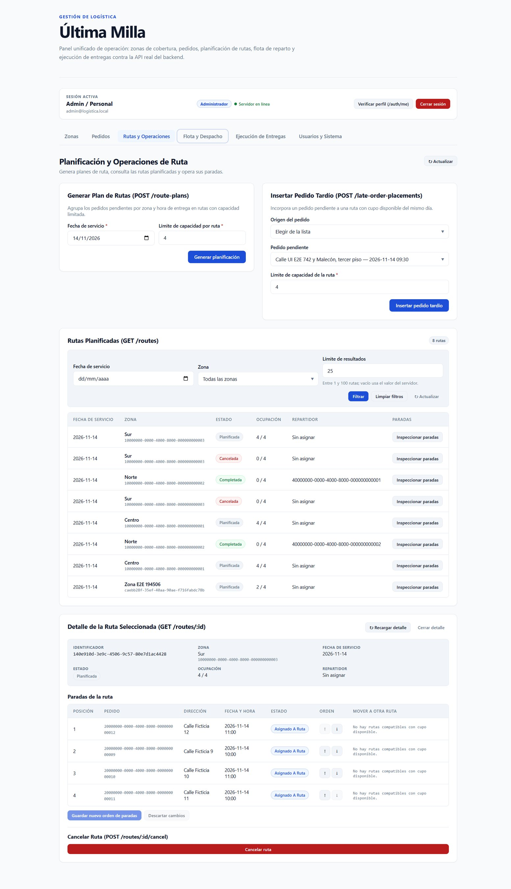

# Guía de prueba manual — Frontend Última Milla (27 endpoints reales)

Este documento describe cómo levantar y probar **manualmente** el frontend web del sistema de
logística de última milla contra el backend real (`develop`, 27 endpoints, JWT + RBAC de 3 roles).

- Repositorio modificado: `GPIS-proyecto-final-ultima-milla-frontend` (rama `develop`).
- Repositorios **no modificados**: `GPIS-proyecto-final-ultima-milla-backend` y `db-proyecto`
  (el paquete de base de datos conserva los hashes de `.ci/database-package.json`; verificado con
  `npm run db:verify`).
- Backend de referencia en ejecución durante la verificación: `http://localhost:3000`.
- Frontend: **`http://127.0.0.1:5173`** (usar exactamente `127.0.0.1`, no `localhost`: el backend
  solo permite ese origen en CORS).

---

## 1. Qué se implementó

El frontend queda organizado por feature con Clean Architecture estricta
(`domain` → `application` → `infrastructure/http` → `presentation`) y un único composition root:

| Feature | Endpoints cubiertos |
| :-- | :-- |
| `features/auth` | `GET /health`, `POST /auth/register`, `POST /auth/login`, `POST /auth/users`, `GET /auth/me`, `POST /auth/logout` |
| `features/zones` | `POST /zones`, `GET /zones`, `GET /zones/:id` |
| `features/orders` | `POST /orders`, `GET /orders`, `GET /orders/:id` |
| `features/routes` | `POST /route-plans`, `GET /routes`, `GET /routes/:id`, `PUT /routes/:id/stop-order`, `POST /routes/:id/cancel`, `POST /route-moves`, `POST /late-order-placements` |
| `features/couriers` | `POST /couriers`, `GET /couriers`, `PATCH /couriers/:id/availability`, `POST /courier-assignments`, `GET /couriers/:id/route` |
| `features/deliveries` | `GET /delivery-orders/:id`, `POST /delivery-status-changes`, `POST /route-completions` |
| `shared/infrastructure/http` | Cliente HTTP único con inyección automática de `Authorization: Bearer`, `PATCH`, `Idempotency-Key` y manejador global de `401` |
| `shared/ui` | `Button`, `TextInput`, `Select`, `Alert`, `Card`, `Spinner`, `EmptyState` + `tokens.css` |

Mejoras al cliente HTTP (`src/shared/infrastructure/http/httpClient.ts`):
`patch()`, proveedor de token, manejador de `401`, y `HttpError.code`/`message` extraídos del sobre
de error del backend (`{ code, message, error: { code, message } }`).



---

## 2. Requisitos previos

- Windows con PowerShell 7 (`pwsh`), Docker Desktop **en ejecución**.
- Node.js 24.x y npm 11.x (los `engines` de ambos repositorios).
- Puertos libres: `3000` (API), `5173` (Vite web), `5432` (PostgreSQL).
- Dependencias ya instaladas en ambos repositorios (`node_modules` presentes). Si no:

```powershell
Set-Location "C:\Users\Matius\Desktop\Universidad\GESTION\proyectofinal\GPIS-proyecto-final-ultima-milla\GPIS-proyecto-final-ultima-milla-backend"; npm ci
Set-Location "C:\Users\Matius\Desktop\Universidad\GESTION\proyectofinal\GPIS-proyecto-final-ultima-milla\GPIS-proyecto-final-ultima-milla-frontend"; npm ci
```

---

## 3. Arranque en 3 pasos

Abre **tres terminales** PowerShell distintas.

### Paso 1 — Base de datos (PostgreSQL en Docker)

```powershell
Set-Location "C:\Users\Matius\Desktop\Universidad\GESTION\proyectofinal\GPIS-proyecto-final-ultima-milla\db-proyecto"
docker compose up -d --wait postgres
docker compose exec -T postgres sh /workspace/database/scripts/migrate.sh
docker compose exec -T postgres psql -X -v ON_ERROR_STOP=1 -U logistica_admin -d logistica -f /workspace/database/seeds/demo.sql
```

Si es la primera vez (o quieres volver al estado inicial con las 4 cuentas de prueba), ejecuta una
vez el script de siembra de credenciales:

```powershell
Set-Location "C:\Users\Matius\Desktop\Universidad\GESTION\proyectofinal\GPIS-proyecto-final-ultima-milla\GPIS-proyecto-final-ultima-milla-frontend\docs\verificacion"
pwsh -NoProfile -File .\reiniciar-entorno.ps1
```

> `reiniciar-entorno.ps1` sin parámetros **recrea el volumen** (`down -v`) y deja migraciones, datos
> demo y credenciales listas. Con `-KeepData` solo reaplica migraciones/semillas sobre los datos
> existentes. Consulta `docs/verificacion/README.md`.

### Paso 2 — Backend (API unificada en `:3000`)

```powershell
Set-Location "C:\Users\Matius\Desktop\Universidad\GESTION\proyectofinal\GPIS-proyecto-final-ultima-milla\GPIS-proyecto-final-ultima-milla-backend"
npm run dev
```

Debe imprimir `API unificada escuchando en http://localhost:3000` y
`PostgreSQL conectado: ...`. Verificación rápida en otra terminal:

```powershell
Invoke-RestMethod http://localhost:3000/health   # -> status = ok
```

### Paso 3 — Frontend web (`127.0.0.1:5173`)

```powershell
Set-Location "C:\Users\Matius\Desktop\Universidad\GESTION\proyectofinal\GPIS-proyecto-final-ultima-milla\GPIS-proyecto-final-ultima-milla-frontend"
npm run dev
```

Abre **`http://127.0.0.1:5173`** en el navegador.

---

## 4. Credenciales de prueba

| Rol (`role` / `publicRole`) | Correo | Contraseña | `courierId` vinculado |
| :-- | :-- | :-- | :-- |
| Administrador (`personal` / `admin`) | `admin@logistica.local` | `Admin1234!` | — |
| Repartidor (`repartidor`) | `repartidor1@logistica.local` | `Repartidor1234!` | `40000000-0000-4000-8000-000000000001` (Repartidor Demo 1) |
| Repartidor (`repartidor`) | `repartidor2@logistica.local` | `Repartidor1234!` | `40000000-0000-4000-8000-000000000002` (Repartidor Demo 2) |
| Cliente (`cliente`) | `cliente@logistica.local` | `Cliente1234!` | — |

En la pantalla de acceso hay botones de **"Cuentas de prueba rápida (Entorno Local)"** que rellenan
el formulario automáticamente.

Datos demo: 3 zonas (`Centro`, `Norte`, `Sur`), 2 repartidores y 12 pedidos pendientes.

---

## 5. Recorrido manual sugerido

### 5.1 Pantalla pública

1. En `http://127.0.0.1:5173` verifica el indicador **"Servidor en línea"** (consume `GET /health`).
   Detén el backend y pulsa **Reintentar**: debe pasar a "Servidor sin conexión".
2. Pestaña **"Registrarse como cliente"**: crea una cuenta nueva (correo válido, contraseña de 8 a
   128 caracteres). Debe iniciar sesión automáticamente (`POST /auth/register`) y abrir el panel
   con las pestañas **Pedidos** y **Zonas**.
3. **Cerrar sesión** (`POST /auth/logout`): vuelve a la pantalla de acceso y el token se borra de
   `localStorage` (clave `gpis_ultima_milla_jwt`).

### 5.2 Flujo Cliente (`cliente@logistica.local` / `Cliente1234!`)

1. Inicia sesión. Solo debe ver 2 pestañas: **Pedidos** (predeterminada) y **Zonas**.
2. **Zonas**: consulta la cobertura y pulsa **"Ver detalle"** en una zona (`GET /zones/:id`). No
   debe existir formulario de alta (mensaje "Modo consulta").
3. **Pedidos**: crea un pedido para **hoy** (`POST /orders`, zona + dirección + fecha + hora). El
   listado solo muestra tus pedidos (`GET /orders`, el backend filtra por tu usuario) y
   **"Ver detalle"** consulta `GET /orders/:id`.
4. **Verificar perfil (/auth/me)** en la barra de sesión y luego **Cerrar sesión**.

### 5.3 Flujo Administrador (`admin@logistica.local` / `Admin1234!`)

1. Inicia sesión: 6 pestañas (Zonas, Pedidos, Rutas y Operaciones, Flota y Despacho, Ejecución de
   Entregas, Usuarios y Sistema).
2. **Zonas**: crea una zona (`POST /zones`) y consulta su detalle (`GET /zones/:id`).
3. **Pedidos**: crea 2–4 pedidos **para hoy** en la misma zona (`POST /orders`) para que la
   planificación tenga material; usa los filtros de fecha/zona y **"Ver detalle"**.
4. **Rutas y Operaciones**:
   1. **Generar planificación** con la fecha de hoy y capacidad `4` (`POST /route-plans`, envía
      `Idempotency-Key`): la alerta de éxito lista los `routeIds` creados y el listado se refresca
      (`GET /routes`).
   2. **Inspeccionar paradas** de una ruta (`GET /routes/:id`).
   3. **Reordenar paradas** con ↑/↓ y **"Guardar nuevo orden de paradas"**
      (`PUT /routes/:id/stop-order`).
   4. **Mover pedido** a otra ruta compatible de la misma zona/fecha con cupo
      (`POST /route-moves`).
   5. **Insertar pedido tardío** (`POST /late-order-placements`): selecciona un pedido pendiente y
      confirma. Resultado esperado: alerta verde con `routeId` o alerta ámbar
      `NO_AVAILABLE_COURIER`.
   6. **Cancelar ruta** (`POST /routes/:id/cancel`) sobre una ruta `planificada` (confirmación
      inline, sin `window.confirm`).
5. **Flota y Despacho**:
   1. **Registrar repartidor** (`POST /couriers`).
   2. **Catálogo de flota** (`GET /couriers`) con filtros Todos / Solo disponibles / No disponibles y
      botón de disponibilidad (`PATCH /couriers/:id/availability`).
   3. **Ver hoja de ruta activa** de un repartidor (`GET /couriers/:id/route`).
   4. **Asignar ruta** planificada a un repartidor disponible (`POST /courier-assignments`).
6. **Usuarios y Sistema**: crea un usuario con rol Administrador/Repartidor/Cliente
   (`POST /auth/users`) y comprueba el historial con UUID; usa **"Verificar sistema"**
   (`GET /health`).
7. Cierra sesión.

### 5.4 Flujo Repartidor (`repartidor2@logistica.local` / `Repartidor1234!`)

> Asigna antes una ruta `planificada` al **Repartidor Demo 2** desde el flujo Administrador (5.5.4).

1. Inicia sesión: solo 4 pestañas — **Ejecución de Entregas** (predeterminada), Rutas y Operaciones,
   Pedidos, Zonas. La barra de sesión muestra el `courierId`.
2. **Ejecución de Entregas**:
   1. **Cargar hoja de ruta** (`GET /couriers/:id/route`).
   2. **Sincronizar** el estado/versión de cada parada (`GET /delivery-orders/:id`).
   3. Avanza cada parada: **Marcar recogido → Marcar en camino → Marcar entregado**
      (`POST /delivery-status-changes` con `Idempotency-Key` y `expectedVersion` como texto).
      Si la versión está desfasada el backend responde `409 DATA_CONFLICT`: vuelve a **Sincronizar**
      y repite.
   4. Con todas las paradas `entregado`, pulsa **Completar Ruta** (`POST /route-completions`).
3. **Rutas y Operaciones**: solo consulta (sin planificar/reordenar/cancelar/mover).
4. **Pedidos** y **Zonas**: solo consulta (sin formularios de alta).
5. **Cerrar sesión**.

> El repartidor no puede operar `/couriers/:id/...` de otro repartidor: el backend responde `403`.
> Tampoco puede listar `/couriers`, crear zonas, crear pedidos, planificar, asignar rutas ni crear
> usuarios: además de la restricción del backend, la interfaz oculta esas acciones.

---

## 6. Matriz de los 27 endpoints (verificados)

`✔ UI` = probado desde la interfaz; `✔ API` = probado con peticiones HTTP directas en la
verificación de extremo a extremo.

| # | Método y ruta | Roles | Verificado |
| :-: | :-- | :-- | :-- |
| 1 | `GET /health` | público | ✔ UI · ✔ API |
| 2 | `POST /auth/register` | público | ✔ UI · ✔ API |
| 3 | `POST /auth/login` | público | ✔ UI · ✔ API |
| 4 | `POST /auth/users` | personal | ✔ UI · ✔ API |
| 5 | `GET /auth/me` | todos | ✔ UI · ✔ API |
| 6 | `POST /auth/logout` | todos | ✔ UI · ✔ API (token revocado → 401) |
| 7 | `POST /zones` | personal | ✔ UI · ✔ API |
| 8 | `GET /zones` | todos | ✔ UI · ✔ API |
| 9 | `GET /zones/:id` | todos | ✔ UI · ✔ API |
| 10 | `POST /orders` | personal, cliente | ✔ UI · ✔ API |
| 11 | `GET /orders` | todos | ✔ UI · ✔ API |
| 12 | `GET /orders/:id` | todos | ✔ UI · ✔ API |
| 13 | `POST /route-plans` | personal | ✔ UI · ✔ API (con `Idempotency-Key`) |
| 14 | `GET /routes` | personal, repartidor | ✔ UI · ✔ API |
| 15 | `GET /routes/:id` | personal, repartidor | ✔ UI · ✔ API |
| 16 | `PUT /routes/:id/stop-order` | personal | ✔ UI · ✔ API |
| 17 | `POST /routes/:id/cancel` | personal | ✔ UI · ✔ API |
| 18 | `POST /route-moves` | personal | ✔ UI · ✔ API |
| 19 | `POST /late-order-placements` | personal | ✔ UI · ✔ API (asignado y `NO_AVAILABLE_COURIER`) |
| 20 | `POST /couriers` | personal | ✔ UI · ✔ API |
| 21 | `GET /couriers` | personal | ✔ UI · ✔ API (`available` / `limit` / `offset`) |
| 22 | `PATCH /couriers/:id/availability` | personal, repartidor (propio) | ✔ UI · ✔ API |
| 23 | `POST /courier-assignments` | personal | ✔ UI · ✔ API |
| 24 | `GET /couriers/:id/route` | personal, repartidor (propio) | ✔ UI · ✔ API |
| 25 | `GET /delivery-orders/:id` | personal, repartidor | ✔ UI · ✔ API |
| 26 | `POST /delivery-status-changes` | personal, repartidor (dueño) | ✔ UI · ✔ API (`expectedVersion` string) |
| 27 | `POST /route-completions` | personal, repartidor (dueño) | ✔ UI · ✔ API |

---

## 7. Reglas del contrato que debes recordar al probar

- **Origen CORS**: siempre `http://127.0.0.1:5173`. Si abres `http://localhost:5173` el navegador
  bloqueará las 27 llamadas por CORS (`WEB_ORIGIN` del backend es `http://127.0.0.1:5173`).
- **JWT automático**: el token se guarda en `localStorage` (`gpis_ultima_milla_jwt`) y el cliente
  HTTP lo inyecta en cada petición. Un `401` limpia la sesión y devuelve a la pantalla de acceso.
- **Idempotencia**: `POST /route-plans`, `POST /late-order-placements` y
  `POST /delivery-status-changes` envían `Idempotency-Key` (UUID generado con `crypto.randomUUID()`
  cuando no se provee). Reenviar la misma operación con la misma clave no duplica efectos.
- **Versiones optimistas**: `expectedVersion` viaja siempre como **texto decimal** (`"1"`, `"2"`, …),
  nunca como número. El frontend lo sincroniza con `GET /delivery-orders/:id` antes de cada
  transición.
- **Capacidad**: `capacityLimit` (`/route-plans`, `/late-order-placements`) y `maxOrdersPerTrip`
  (`/couriers`) se envían como **número entero**.
- **Fechas**: `deliveryDate`/`serviceDate` en `YYYY-MM-DD` y `deliveryTime` en `HH:mm`. El backend
  rechaza fechas pasadas (zona `America/Guayaquil`); crea los pedidos para **hoy** o una fecha
  futura para poder planificar.
- **Estados**: pedidos `pendiente → asignado_a_ruta → recogido → en_camino → entregado`; rutas
  `planificada → asignada → en_curso → completada` (o `cancelada` antes de la salida).

---

## 8. Verificación automática ya ejecutada

- `npm run typecheck` y `npm run build` del frontend: **0 errores**, build de producción correcto
  (131 módulos).
- Prueba HTTP de extremo a extremo de los 27 endpoints contra el backend real + PostgreSQL:
  **64/64 aserciones correctas** (incluye RBAC: repartidor y cliente reciben `403` en acciones de
  personal; `401` tras `logout`; replay idempotente de `POST /route-plans`).
- Recorrido en navegador (perfil de los 3 roles) **sin errores ni advertencias en consola** y sin
  peticiones fallidas.
- Auditorías de calidad: arquitectura limpia (`domain`/`application` sin React/DOM/HTTP, sin `any`),
  paridad de los 27 endpoints (ruta, método, cabeceras y tipos) y UX/accesibilidad/copy en español.
  Los hallazgos menores detectados (selección por defecto de *pedido tardío*, exclusión de
  repartidores con ruta activa en la asignación, refresco del catálogo tras planificar, patrón ARIA
  de pestañas, colores por tokens y textos de estados vacíos) fueron corregidos y re-verificados.
- `git status` del backend sin archivos rastreados modificados y `npm run db:verify` correcto en el
  paquete de base de datos.

---

## 9. Cómo apagar todo

1. `Ctrl+C` en la terminal del frontend (liberando `5173`).
2. `Ctrl+C` en la terminal del backend (liberando `3000`).
3. PostgreSQL puede quedarse encendido (es lo deseado para seguir probando):

```powershell
Set-Location "C:\Users\Matius\Desktop\Universidad\GESTION\proyectofinal\GPIS-proyecto-final-ultima-milla\db-proyecto"
docker compose ps        # logistica-postgres-1 ... (healthy)
# Si quieres apagarlo (conservando los datos):
docker compose stop postgres
```

---

## 10. Problemas frecuentes

| Síntoma | Causa probable | Solución |
| :-- | :-- | :-- |
| Todas las llamadas fallan por CORS en la consola | Se abrió `http://localhost:5173` | Abre **`http://127.0.0.1:5173`** |
| "Servidor sin conexión" en la pantalla de acceso | Backend apagado o `DATABASE_URL` inválida | Revisa la terminal del backend y `GET /health` |
| `401` inmediato tras iniciar sesión | Token revocado o `JWT_SECRET` distinto entre reinicios | Vuelve a iniciar sesión (el frontend limpia el token) |
| "No hay pedidos pendientes disponibles" al planificar | Los pedidos son de otra fecha | Crea pedidos para **hoy** y vuelve a planificar |
| `409 DATA_CONFLICT` al avanzar una entrega | Versión desactualizada | Pulsa **Sincronizar** y repite la transición |
| `409` al asignar ruta | El repartidor tiene ruta activa o no tiene capacidad suficiente | Elige otro repartidor u otra ruta (el selector ya filtra) |
| Docker no responde | Docker Desktop detenido | Inicia Docker Desktop y espera a `docker info` |
| El backend no arranca por puerto 3000 ocupado | Otro proceso en `:3000` | `Get-NetTCPConnection -LocalPort 3000` y cierra el proceso |

---

## 11. Estructura de archivos relevante

```text
src/
  bootstrap/
    app.tsx                    # shell: sesión, pestañas por rol, composición de vistas
    compose-use-cases.ts       # composition root: gateways + casos de uso (27 endpoints)
    styles.css
  shared/
    infrastructure/http/       # cliente HTTP único (JWT, PATCH, Idempotency-Key, 401)
    ui/                        # design system + tokens
  features/
    auth/{domain,application,infrastructure/http,presentation}
    zones/{...}
    orders/{...}
    routes/{...}
    couriers/{...}
    deliveries/{...}
docs/
  GUIA_PRUEBA_MANUAL.md        # este documento
  verificacion/
    README.md
    reiniciar-entorno.ps1      # reinicio + migraciones + semillas
    sembrar-usuarios-prueba.sql# 4 cuentas con hash Scrypt
    capturas/                  # capturas de la verificación en vivo
```
